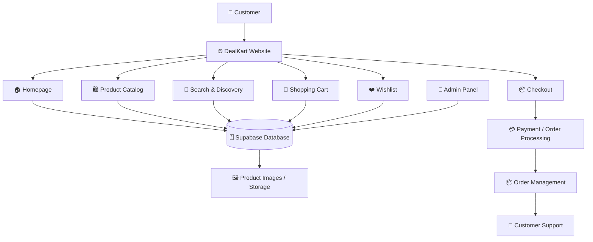
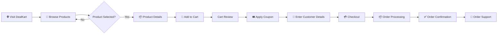
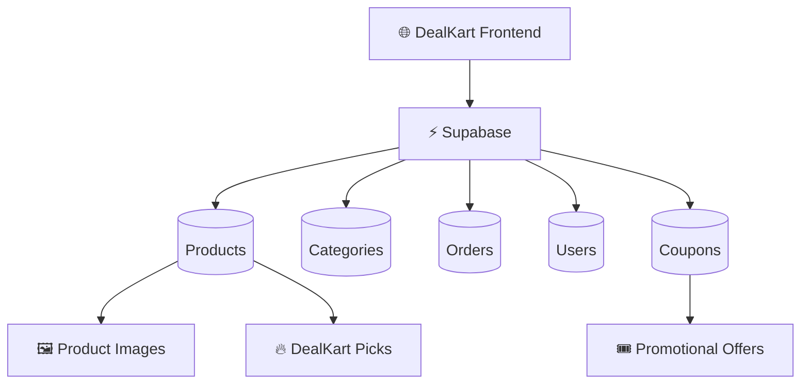

# 🛍️ DealKart

<p align="center">
  <h1 align="center">DEALKART</h1>
  <p align="center">
    <strong>Discover More. Spend Less.</strong>
  </p>
  <p align="center">
    A modern e-commerce platform built to make discovering great products and better deals simple, fast, and convenient.
  </p>
</p>

<p align="center">

[](https://dealkart-flax.vercel.app/)
[](https://nextjs.org/)
[](https://react.dev/)
[](https://tailwindcss.com/)
[](https://supabase.com/)
[](https://vercel.com/)

</p>

---

## 🌐 Live Website

<p align="center">

### 🛍️ [Visit DealKart](https://dealkart-flax.vercel.app/)

**https://dealkart-flax.vercel.app/**

</p>

---

# 📖 About DealKart

**DealKart** is a modern e-commerce platform focused on making online shopping simpler, faster, and more deal-oriented.

The platform combines a responsive storefront with centralized product management, curated deals, shopping-cart functionality, wishlist support, coupon functionality, and an administrative product-management system.

### 🎯 Core Philosophy

```text
        DISCOVER
           ↓
        EXPLORE
           ↓
        COMPARE
           ↓
          SAVE
           ↓
         SHOP
```

DealKart is designed around one simple idea:

> **Great Products. Better Deals.**

---

# ✨ Key Features

| Feature              | Description                                          |
| -------------------- | ---------------------------------------------------- |
| 🏠 Modern Homepage   | Hero sections, featured products and curated deals   |
| 🔎 Product Discovery | Search, categories, product grids and deal sections  |
| 🔥 DealKart Picks    | Curated and ranked featured products                 |
| 📦 Product Details   | Images, pricing, discounts, ratings and descriptions |
| 🛒 Shopping Cart     | Quantity management and complete price breakdown     |
| ❤️ Wishlist          | Save products for later                              |
| 🎟️ Coupons          | Promotional coupon functionality                     |
| 🔐 Admin Panel       | Centralized product management                       |
| 🗄️ Supabase         | Centralized product/database infrastructure          |
| 📱 Responsive UI     | Desktop, tablet and mobile support                   |
| ⚡ Performance        | Optimized shopping experience                        |

---

# 🏠 Homepage

The DealKart homepage is designed around product discovery.

### Includes

* Hero section
* Featured deals
* DealKart Picks
* Product categories
* Promotional sections
* Product grids
* Responsive navigation
* Shopping cart access
* Wishlist functionality

### Preview

Add your actual homepage screenshot here:

```text
docs/screenshots/homepage.png
```

```markdown

```

---

# 🛍️ Product Discovery

Customers can discover products through:

* 🔎 Search
* 🗂️ Categories
* 💰 Discount pricing
* ⭐ Ratings
* 💬 Reviews
* 🔥 Featured products
* 🏆 Top deals
* 🖼️ Product imagery

The product-card experience is designed to make the important information visible at a glance.

---

# 📦 Product Details

Each product page provides important information before purchase.

### Product information

```text
┌───────────────────────────────────────┐
│             PRODUCT PAGE              │
├───────────────────────────────────────┤
│                                       │
│  🖼️ Product Gallery                  │
│                                       │
│  Product Name                         │
│  Brand                                │
│                                       │
│  ₹ Selling Price                      │
│  ₹ MRP                                │
│  💰 Discount                          │
│                                       │
│  ⭐ Rating & Reviews                  │
│                                       │
│  • Key Product Point                  │
│  • Key Product Point                  │
│  • Key Product Point                  │
│                                       │
│  Description                          │
│  Delivery Information                 │
│  Return Information                   │
│                                       │
└───────────────────────────────────────┘
```

### Supported information

* Product name
* Brand
* Category
* Selling price
* MRP
* Discount
* Ratings
* Reviews
* Product images
* Key points
* Description
* Delivery information
* Return information

---

# 🔥 DealKart Picks

**DealKart Picks** is a curated product section for specially selected deals.

Products can be promoted and ranked through the administration system.

```text
              🔥 DEALKART PICKS

        ┌──────────────────────┐
        │ 🥇     TOP DEAL      │
        ├──────────────────────┤
        │ 🥈  FEATURED DEAL    │
        ├──────────────────────┤
        │ 🥉  TRENDING DEAL    │
        └──────────────────────┘
```

---

# 🛒 Shopping Cart

DealKart provides a transparent cart-pricing experience.

### Cart calculation

```text
             PRODUCT MRP
                  │
                  ▼
          PRODUCT DISCOUNT
                  │
                  ▼
        DISCOUNTED SUBTOTAL
                  │
                  ▼
           COUPON DISCOUNT
                  │
                  ▼
          FINAL PAYABLE
```

### Cart functionality

* Add products
* Remove products
* Increase quantity
* Decrease quantity
* Apply coupons
* View product savings
* View subtotal
* View final payable amount

---

# 🎟️ Coupon System

DealKart supports promotional coupon codes.

| Coupon     | Benefit |
| ---------- | ------: |
| `NEW05`    | ₹19 OFF |
| `FIRSTBUY` | ₹19 OFF |

The coupon system is designed to support promotional campaigns and cart-value-based offers.

---

# ❤️ Wishlist

Customers can save products that they are interested in.

The wishlist makes it easier to:

```text
Discover Product
      ↓
Save Product ❤️
      ↓
Return Later
      ↓
Add to Cart 🛒
```

---

# 🔐 Admin Panel

DealKart includes an administrative product-management system.

The admin interface allows authorized administrators to manage the product catalog without directly modifying application code.

### Admin capabilities

```text
                     ADMIN PANEL
                          │
          ┌───────────────┼───────────────┐
          │               │               │
          ▼               ▼               ▼
        ADD             EDIT           DELETE
      PRODUCT          PRODUCT         PRODUCT
          │               │               │
          └───────────────┼───────────────┘
                          │
                          ▼
                   SUPABASE DATABASE
                          │
                          ▼
                   DEALKART WEBSITE
```

### Product management

* ➕ Add products
* ✏️ Edit products
* 🗑️ Remove products
* 🖼️ Manage product images
* 🔥 Promote products
* 🔢 Rank Top 10 products
* 👁️ Activate/deactivate products
* 📝 Update descriptions
* 💰 Update pricing

---

# 🏗️ System Architecture



---

# 🔄 Customer Shopping Flow



---

# 🗄️ Database Architecture

DealKart uses **Supabase** as the centralized backend/database layer.



This centralized architecture allows product information to be managed from one location and reflected across the storefront.

---

# 🧑‍💻 Technology Stack

## Frontend

| Technology              | Purpose                   |
| ----------------------- | ------------------------- |
| ⚛️ React                | User interface            |
| ▲ Next.js               | Web application framework |
| 🎨 Tailwind CSS         | Responsive styling        |
| TypeScript / JavaScript | Application logic         |

## Backend & Data

| Technology           | Purpose                       |
| -------------------- | ----------------------------- |
| 🟢 Supabase          | Database and backend services |
| 🗄️ PostgreSQL       | Structured application data   |
| 🖼️ Supabase Storage | Product assets/images         |
| 🔌 API Layer         | Application communication     |

## Deployment

| Platform | Purpose                |
| -------- | ---------------------- |
| GitHub   | Source-code management |
| Vercel   | Production deployment  |

---

# 📁 Project Structure

```text
dealkart/
│
├── public/
│   ├── images/
│   ├── icons/
│   └── favicon/
│
├── docs/
│   ├── assets/
│   │   └── dealkart-logo.png
│   │
│   └── screenshots/
│       ├── homepage.png
│       ├── products.png
│       ├── product-page.png
│       ├── cart.png
│       ├── checkout.png
│       └── admin.png
│
├── src/
│   ├── components/
│   ├── app/
│   ├── pages/
│   ├── lib/
│   ├── hooks/
│   └── utils/
│
├── .env.local
├── package.json
├── next.config.js
├── tailwind.config.js
└── README.md
```

---

# ⚙️ Installation

## 1. Clone the repository

```bash
git clone https://github.com/your-username/dealkart.git
cd dealkart
```

## 2. Install dependencies

```bash
npm install
```

## 3. Configure environment variables

Create a `.env.local` file:

```env
NEXT_PUBLIC_SUPABASE_URL=your_supabase_url
NEXT_PUBLIC_SUPABASE_ANON_KEY=your_supabase_anon_key
SUPABASE_SERVICE_ROLE_KEY=your_supabase_service_role_key
```

> ⚠️ Never expose your Supabase Service Role Key in client-side code.

## 4. Start the development server

```bash
npm run dev
```

Open:

```text
http://localhost:3000
```

---

# 🚀 Production Build

```bash
npm run build
```

Start the production server:

```bash
npm start
```

---

# 🔒 Security

DealKart keeps sensitive configuration outside the public source code.

### Never commit

```text
.env
.env.local
.env.*.local
API Keys
Database Passwords
Service Role Keys
Private Tokens
Admin Credentials
```

Recommended `.gitignore`:

```gitignore
.env
.env.local
.env.*.local
```

---

# ⚡ Performance

DealKart is designed with performance in mind.

### Optimization areas

* 🖼️ Image optimization
* ⚡ Efficient product loading
* 🔄 Reduced unnecessary requests
* 📱 Responsive images
* 🧩 Reusable components
* 🗄️ Efficient database queries
* 🚀 Production deployment through Vercel

### Performance flow

```text
       FAST LOAD
           ↓
   FAST DATA FETCH
           ↓
   FAST PRODUCT RENDER
           ↓
   SMOOTH NAVIGATION
           ↓
 BETTER SHOPPING EXPERIENCE
```

---

# 📱 Responsive Design

DealKart is designed to work across different screen sizes.

```text
┌──────────────────────────────────────────┐
│                 DESKTOP                  │
│                                          │
│       Full E-Commerce Experience        │
└──────────────────────────────────────────┘
                    ↓
┌────────────────────────────┐
│           TABLET           │
│                            │
│      Responsive Layout     │
└────────────────────────────┘
                    ↓
┌──────────────────────┐
│        MOBILE        │
│                      │
│   Mobile Shopping    │
└──────────────────────┘
```

---

# 📸 Screenshots

For the GitHub repository, add the actual DealKart screenshots inside:

```text
docs/screenshots/
```

Recommended showcase:

| Screenshot          | File               |
| ------------------- | ------------------ |
| 🏠 Homepage         | `homepage.png`     |
| 🛍️ Product Listing | `products.png`     |
| 📦 Product Page     | `product-page.png` |
| 🛒 Cart             | `cart.png`         |
| 💳 Checkout         | `checkout.png`     |
| 🔐 Admin Panel      | `admin.png`        |

Then display them in the README:

```markdown


```

---

# 🗺️ Roadmap

## 🛒 Shopping

* [ ] Customer accounts
* [ ] Advanced product filtering
* [ ] Product recommendations
* [ ] Product reviews
* [ ] Order tracking

## 💳 Payments

* [ ] Payment gateway integration
* [ ] Automated payment verification
* [ ] Automated order confirmation

## 📦 Orders

* [ ] Complete order management
* [ ] Automated order status
* [ ] Shipping integration
* [ ] Customer notifications

## 📊 Admin

* [ ] Sales analytics
* [ ] Inventory management
* [ ] Customer analytics
* [ ] Revenue dashboard

---

# 🤝 Contributing

Contributions and suggestions are welcome.

```bash
# Create a feature branch
git checkout -b feature/new-feature

# Make changes
git add .

# Commit
git commit -m "Add new feature"

# Push
git push origin feature/new-feature
```

Then create a Pull Request.

---

# 🐛 Bug Reports

If you discover a bug, please include:

1. Bug description
2. Steps to reproduce
3. Expected behaviour
4. Actual behaviour
5. Screenshot or video
6. Browser/device information

---

# 🌐 Live Project

<p align="center">

## 🛍️ DealKart

### [Visit the Live Website →](https://dealkart-flax.vercel.app/)

**https://dealkart-flax.vercel.app/**

</p>

---

# 📄 License

This project is maintained as a private/commercial project.

The DealKart brand, design, source code and proprietary assets may not be copied, redistributed or commercially reused without permission.

---

<p align="center">

# 🛍️ DealKart

### **Great Products. Better Deals.**

**Discover • Compare • Save**

<br>

⭐ **Built with ❤️ for a better online shopping experience.**

</p>
